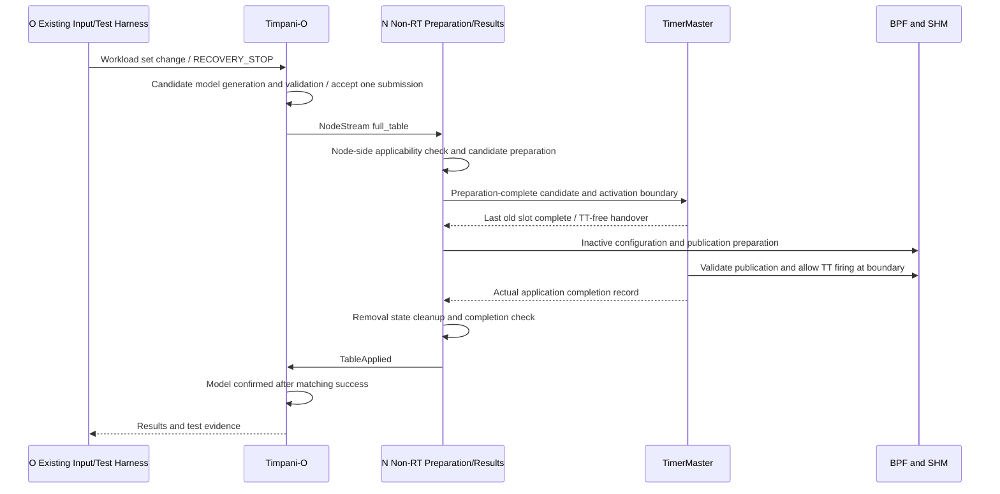

<!--
SPDX-FileCopyrightText: Copyright 2026 LG Electronics Inc.
SPDX-License-Identifier: MIT
-->

# HLD-011: Runtime Table Update — Phase 0 High-Level Design

**Date:** 2026-10-28  
**Status:** Draft — design proposal, not a claim that the current implementation satisfies the requirements  
**Parent baseline:** [REQ-011](REQ-011-runtime-table-update.md) §1.5·§7.1, [SRS-011](SRS-011-runtime-table-update.md)  
**Decisions/details:** [DDR-011](DDR-011-runtime-table-update.md), [LLD-011](LLD-011-runtime-table-update.md)

## 1. Scope and Structure

The scope is a single node, one or more pre-designated isolated CPUs (core pinning of retained tasks), L1 TT, and a fixed epoch/node-wide hyperperiod. Four semantic operations, including removal caused by recovery STOP, are verified through the single existing full_table path. This document defines only responsibilities and the normal flow, and does not design CBS, cross-core migration of active tasks, rollback, reconnection, multi-node protocols, or a framework for future extension.

The flow above is the required design. It is not to be read as already established by the receive-callback return or index change in the current source alone.

## 2. Separation of Responsibilities

| Component | Phase 0 Responsibilities | What It Does Not Do |
|:--|:--|:--|
| O input/recovery/test path | Accepting workload sets, semantic operations, and `RECOVERY_STOP`; submitting the next one after the result of the current one; for STOP, returning the completion reply after confirming the correlated ACK | Placing tables directly into N and judging end-to-end success; replacing table changes with `RecoverySignal` |
| O generation path | Copying the candidate model; computing the node-wide harmonic hyperperiod and verifying schedulability; pinning retained tasks to their CPUs and confirming preservation of their slots and parameters | Delegating placement decisions to N; cross-core migration of active tasks; modifying the confirmed model before validation |
| O NodeStream handling | Sending the existing full_table; linking results by node/table ID; confirming after success | Request queuing, merging, automatic retransmission, or new RPCs |
| N receive/non-RT coordination | Basic checks (including the isolated CPU set, a single CPU per task, and unchanged CPUs of retained tasks), task/PID resolution, preparation and discard of candidate resources, cleanup, logging, and ACK | gRPC calls on RT threads; deleting active entries during candidate preparation |
| BpfLoader/BPF | Preparing the inactive bank of the TT configuration; maintaining per-task assigned CPUs and atomic execution counts; isolating the assigned core's local queue during handover; consistency between actual kernel selection and execution boundaries | Changing only the C++ index and treating the switchover as complete |
| TimerMaster | In a single resident RT loop: completion of existing executions of slots on multiple isolated CPUs, computation of the next slot on the same core, handover synchronization across all cores, normal boundary switchover, and firing | Creating and joining RT threads on every update; building maps, allocating memory, or printing logs in RT |
| libttsched/TT app | Interpreting valid publications, rechecking generation, and executing only actual slot wake-ups as jobs | Consuming publication notifications or invalid SHM as normal jobs |
| Test harness | Collecting execution, publication, and result evidence; aborting the test when test preconditions are violated | Guaranteeing the product's safety stop or automatic recovery on its behalf |

The existing public methods, proto, and SHM struct layouts are maintained. Internal coordination state and helper functions are confined to the module, and separate approval is obtained if a new public API becomes necessary. Existing fault monitoring is not disabled, and safety mechanisms are not removed. The fault callback only reports and does not remove workloads on its own; preserving the fault-accumulation state of unaffected workloads before and after an update, and recovering from switchover failure, are deferred to Phase 2.

## 3. H-P0-01 — Input, Generation, and Confirmed State

O distinguishes only `confirmed` and a single `candidate` on a single node with a pre-designated set of isolated CPUs (`0..63`). Test input calls the existing generation path and does not hand-assemble schedule tables for bypass injection into N. When generating a candidate, a single node-wide harmonic hyperperiod is computed over the TT periods of the entire node so that all isolated CPUs share the same time grid; existing confirmed tasks are pinned to their originally assigned CPUs, and only newly added workloads are assigned with priority to unused isolated CPUs (or to the least-loaded CPU when there are not enough). REMOVE uses the same candidate-generation path for both the existing `RecoveryService.EnforceRecoveryPolicy(RECOVERY_STOP)` and O's internal test input (yielding an empty table when no workloads remain), and in Phase 0 no `RecoverySignal` broadcast is sent.

On candidate generation or validation failure and on N's pre-rejection, `confirmed` is retained. If a single task spans multiple CPUs, if the assigned CPU of a retained task changes, or if the retained slots or parameters differ under ADD/REMOVE, the change is rejected as unsupported. The candidate is confirmed only after a successful result that matches NodeStream's current request, and delivery success is not the same as successful application. A regular candidate submission returns after registration, whereas `RECOVERY_STOP` confirms a correlated success ACK within a finite wait deadline, so that the caller terminates workloads only after node cleanup completes, and then returns success and keeps the session (failure is returned on pre-rejection, an in-progress conflict, or an unconfirmed ACK).

This distinction is basic state management in Phase 0; it is not extended to last-known-good persistence, merging of request intents (including pending STOPs), harmless convergence of repeated STOPs, or a restart recovery model.

## 4. H-P0-02 — N Pre-Checks and Inactive Preparation

N checks only the target, identifiers, values/representations, whether an isolated CPU mask is included, single-CPU assignment per task, unchanged CPUs of retained tasks, local references, current capacity, and fixed test conditions. Inter-slot overlap and schedulability remain the responsibility of O.

A candidate contains the sorted TT slots, the bitmask of isolated CPUs in use, the resolved PIDs and hashes including the per-task assigned CPUs, the SHM publication image, the removal set, and the activation boundary and completion record. This data is built on the non-RT path and treated as immutable after preparation. The approach of clearing the active TT configuration and then filling in the candidate in sequence is not used.

The task metadata holding the BPF TT slots and per-task assigned CPUs is prepared as a configuration bank that is selected together with them. Before reusing a bank, confirm that the kernel/timer processing referencing that bank has finished. This is a reference-lifetime rule for normal switchover, not the general retirement/retry state machine of Phase 1.

Additional requests received during acceptance are rejected immediately. A preparation failure discards only the inactive candidate, and a failure at this point is not confused with rollback after switchover.

## 5. H-P0-03 — Normal Boundary Handover

Time uses the existing epoch `E` of `CLOCK_REALTIME` and the node-wide positive hyperperiod `H` converted to ns. The next start time reported at each slot firing is computed not from the next slot in the whole array but from the next slot on the same CPU. The selected activation boundary is $T=E+kH$, and the test table has a sufficient common TT-free interval `[G,T)` up to `T` on all isolated CPUs in use, after the last old TT job has finished.

1. The candidate is prepared on the non-RT path. If preparation is late before handover starts, the active table is left as is and a later boundary is selected.
2. After completing the last old slot, the existing timer records that handover is possible. If any isolated CPU involved in the active or candidate table still has old TT jobs, pending executions, or kernel references, preparation is not regarded as complete.
3. In `[G,T)`, new TT dispatch is closed, and while the TT gate is closed, woken TT tasks are held non-preemptively in the local queue of their own assigned CPU so that they do not spill over to sibling isolated cores. On the non-RT path, the kernel configuration selection, the slot-state initialization on every CPU involved (cores becoming empty are reset to idle; cores that still have slots have the first slot time after the boundary set), and the SHM publication are prepared. Even if the physical change of the selector happens first, TT does not execute and SHM SHALL be in the invalid state.
4. At `T`, the resident timer hands over the timer context, SHM validity, and TT execution permission through a fixed number of atomic stores of pre-prepared values. **Before any actual slot firing thereafter, all representations SHALL refer to the same candidate.**
5. The fact of actual application completion is passed to the non-RT path as a small internal record. On that path, the result is sent after cleaning up and confirming the removal items.

Execution blocking during the TT-free interval and SHM invalidation are normal switchover synchronization. They are not exposed as a restore-failed stop or as the general node health state. An error after the start of handover, or incomplete boundary preparation, is a test failure, and automatic restoration is not promised.

The planned boundary `T` and the observed actual completion time are recorded separately. Numerical guarantees for observation error, jitter, and worst-case latency are targeted for Phase 1. An arbitrarily delayed time SHALL NOT be adopted as a new epoch.

Even for CLEAR, the time reference and control path are maintained. The timer SHALL remain in an idle state without TT firing, waiting along the same grid, and SHALL be able to receive subsequent candidates.

## 6. H-P0-04 — Application Visibility and Removal

The SHM structure is maintained, and the existing `magic`, `generation`, task name, and `counter` are used. During publication, reads are invalidated, and reads whose generation has changed are discarded. Final validation is not performed before the boundary. Consumers also recheck validity, generation, and their own task before and after reading and after futex return.

The existing mapping that preserves the indices/counters of retained tasks is used, and publication does not increment every counter. Only actual TT firing increments job counters. Removed tasks SHALL disappear from valid-publication lookups. Immediately after removal, a latency bound for wake-up or interoperability with older-version apps is not even guaranteed.

Removed TT maps, task registrations, and trace references are cleaned up upon normal completion. OS policy/affinity restoration and container termination are not responsibilities of this path. Even if another task uses the SHM slot, consumers recheck their identity so that an old waiter does not consume that wake as its own job.

## 7. H-P0-05 — Results and Test Boundary

N's success is the result after confirming, across kernel, timer, and app, the same boundary application and normal cleanup. Only the existing `table_id/success/error` of `TableApplied` is used, and no result-code schema is added.

Pre-rejection and errors during switchover are distinguished in the logs. In the latter case, it is not claimed that the previous table was retained. The test harness aborts further submissions upon unconfirmed results or connection/clock anomalies. This abort is a test procedure, not a product fail-safe function.

Evidence links table/node IDs, operation/target, planned and actual times, old/new banks, SHM generation, executing task, and result to the existing logs and test result files. No new persistent audit store is introduced.

## 8. Differences Between Current Code and Design

| Source checked | Current observation and differences required by the Phase 0 design |
|:--|:--|
| [N apply callback](../../timpani-n/src/main.cpp) | Immediately after receipt, performs deletion of existing entries, affinity changes, and map rewriting. Pre-checks/candidate preparation SHALL be separated from normal boundary cleanup |
| [BpfLoader](../../timpani-n/src/bpf_loader.cpp) | Writes to a single TT/meta map, and the shadow methods change only the user index. Linking the actual kernel configuration selection with handover is needed |
| [TimerMaster](../../timpani-n/src/timer_master.cpp) | During SHM republication, performs a full wake and thread stop/start. Distinguishing boundary handover from control wake is needed |
| [libttsched](../../sample-apps/src/libttsched.c) | Generation/task rechecking after waiting is not sufficient. SHALL avoid mistaking publications or other tasks' wake-ups for jobs |
| [O result handling](../../timpani-o/src/orchestrator_service.cpp) | ACKs are printed to the log. SHALL be linked to matching-request verification and to model confirmation after success |

The table above is a starting point for the design, not an implementation task list or a declaration of completion. Related source changes, builds, and hardware verification are not included in the creation of this document.

## 9. SRS Traceability

| HLD area | Active SRS requirements | Verification |
|:--|:--|:--|
| H-P0-01 | REQ-RTU-P0-F-001..F-004, REQ-RTU-P0-F-016 | TC-P0-01..TC-P0-04, TC-P0-06 |
| H-P0-02 | REQ-RTU-P0-F-005..F-008, REQ-RTU-P0-N-003 | TC-P0-04, TC-P0-06 |
| H-P0-03 | REQ-RTU-P0-F-009..F-011, REQ-RTU-P0-N-001, REQ-RTU-P0-N-002 | TC-P0-01, TC-P0-03, TC-P0-08 |
| H-P0-04 | REQ-RTU-P0-F-012..F-014 | TC-P0-02, TC-P0-03, TC-P0-05 |
| H-P0-05 | REQ-RTU-P0-F-015, REQ-RTU-P0-F-017, REQ-RTU-P0-F-018, REQ-RTU-P0-N-004 | TC-P0-07, TC-P0-08 |
