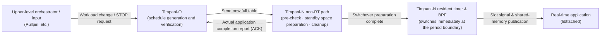
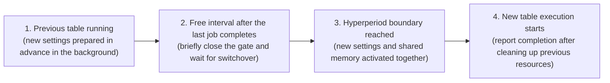

<!--
SPDX-FileCopyrightText: Copyright 2026 LG Electronics Inc.
SPDX-License-Identifier: MIT
-->

# OVERVIEW-011: Runtime Table Update Design Overview

**Date:** 2026-11-11  
**Status:** Draft  
**Current design baseline:** Phase 0 — Runtime Table Update basic operation check  
**Related documents:** [REQ-011](REQ-011-runtime-table-update.md), [SRS-011](SRS-011-runtime-table-update.md), [HLD-011](HLD-011-runtime-table-update.md), [DDR-011](DDR-011-runtime-table-update.md), [LLD-011](LLD-011-runtime-table-update.md)

---

## 1. What Problem Does This Feature Solve?

Even while a vehicle or real-time system is operating, situations arise in which the driving mode changes, new features are added, or a workload that has run into a problem must be stopped.

**Runtime Table Update (runtime schedule table update)** is a feature that safely changes the schedule table of a running node without stopping the system. It has three core goals.

- **Zero-downtime execution:** The Timpani-O and Timpani-N daemons, as well as existing workloads that the change does not affect, keep running without being restarted.
- **Clean batch switchover:** Jobs that have already started are not cut off midway. At a predetermined period boundary (hyperperiod boundary), the schedule switches from the previous table to the new one all at once. Two tables are never executed in a mixed fashion.
- **Clear separation of roles:** Schedule computation and placement are handled solely by the central **Timpani-O**. Each node's **Timpani-N** only checks whether the table it receives can run on that node, and then executes it unchanged at the designated time.

---

## 2. What Kinds of Changes Does It Support?

Schedule changes that occur in actual operation fall into five categories.

| Change type | Intuitive meaning | Example situation | Applicable phase |
|:--|:--|:--|:--|
| **Full replacement (REPLACE)** | Replace the entire schedule table with a new table | Mode transition: parking mode → highway mode | Phase 0 / 1 |
| **Workload addition (ADD)** | Add only new workloads, leaving existing workloads as they are | Deploy a new app to a running node | Phase 0 |
| **Workload removal (REMOVE)** | Remove only some workloads and retain the rest as they are | Undeploy a specific app, or stop a faulty workload (`STOP`) | Phase 0 |
| **Clear (CLEAR)** | Take down all workloads and switch the node to an empty (idle) state | Withdraw all real-time jobs from the node and then wait | Phase 0 |
| **In-place parameter change (MODIFY)** | Change only the period, budget, and CPU while retaining the workload list | Adjust the timing conditions of running jobs | Phase 1 |

> **Design point — the delivery method is always a single 'full table (Full Snapshot)'**  
> Semantically, these are "additions" or "removals," but instead of complex partial-modification commands, the **complete table with the change reflected** is sent to the node. Even when a specific workload is stopped for fault recovery (`RECOVERY_STOP`), it is not removed directly through a separate stop signal; instead, a new full table that excludes that workload is sent and switched over safely in the same way.

---

## 3. Why Divide the Work into Phases (Phase 0 / 1 / 2)?

Implementing multi-node synchronization and all failure recovery at once from the start would make the complexity excessively large. Therefore, the feature is completed sequentially in three phases, and **the design baseline of the current 011 document set is Phase 0**.

| Phase | Core goal | Scope covered |
|:--|:--|:--|
| **Phase 0 (current baseline)** | **Basic switchover behavior check** | Single node · one or more pre-designated isolated CPUs (retained active tasks stay pinned to their existing assigned cores) · L1 (TT) workloads · confirmation of zero-downtime boundary switchover for replace/add/remove (including recovery `STOP`)/clear on a fixed time base, and a check of basic input rejection |
| **Phase 1** | **Feature extension and quality assurance** | L2 (CBS) workloads, in-place parameter change (MODIFY) and cross-core migration of active tasks, changes to period and isolated CPU configuration, per-core timer extension and multi-node extension, waiting and merging of concurrent requests, quantitative verification of jitter and latency bounds |
| **Phase 2** | **Fail-Safe (failure and safe recovery)** | Automatic rollback and safe stop on failure during switchover, automatic resynchronization after communication loss or restart, response to clock anomalies, preservation of accumulated fault records |

---

## 4. Who Takes on Which Role?

- **Upper-level orchestrator (Pullpiri, etc.):** Decides which workloads to run or stop and makes the request. When a workload is stopped due to a fault (`STOP`), the container is terminated only after a completion reply is confirmed, indicating that schedule cleanup on the node has finished.
- **Timpani-O (the only schedule generator):** Does not overwrite the currently confirmed model directly; instead, it creates a separate 'candidate table' and verifies schedulability. Only after the node reports that it has finished applying the change at the actual boundary does it promote the candidate to the confirmed state.
- **Timpani-N non-real-time (Non-RT) path:** Exclusively handles heavy preparation and cleanup. It pre-checks whether the input is valid, prepares the new settings in a standby space that does not affect current execution, and, once switchover is complete, releases the previous resources and reports the result.
- **Timpani-N real-time (RT) timer & kernel (BPF):** The real-time (RT) path performs no memory allocation, map writes, network communication, or log output. It activates the pre-prepared configuration at the period boundary with only a lightweight switch.
- **Real-time application (`libttsched`):** Reads the table published in shared memory and acts on it. It does not read transitional data while the table is being replaced, and it performs its job only when it is actually its own turn to execute.

---

## 5. How Tables Are Replaced Without Stopping

To replace the table without disturbing running jobs, it combines **dual-bank preparation (Double Buffering)** and **period-boundary switchover**.

### Step 1: Candidate Verification and Background Preparation
When Timpani-O keeps existing active tasks pinned to their original cores and sends a new table in which only new workloads are assigned to empty (or least-loaded) cores, Timpani-N first checks whether the target node, required values, isolated CPU set, and per-task core pinning are valid. If there is a problem, such as a single task spanning multiple cores or an existing task's core being changed, it immediately rejects the table to safely protect the currently running table.

If there is no problem, the new slots and per-task assigned-CPU information are written into the empty standby space among the kernel (BPF) **dual banks (for current execution / for next standby)**, and the new shared-memory view to be presented to applications is also prepared in advance. (Only one update is processed at a time; additional requests that arrive during processing are rejected.)

### Step 2: Waiting for Handover in the Free Interval (TT-free Interval)
On all isolated cores in use, it waits for the common TT-free interval, which runs from the end of the last job slot of the current period until the next period boundary. After it confirms that the jobs that were in progress on all participating cores have finished, it closes the gate so that no new job cuts in or spills over to other isolated cores, holds jobs per assigned core, and marks the shared memory as 'updating' so that applications cannot read half-updated information. If preparation falls behind, it does not force the switchover; it defers it to the next period boundary.

### Step 3: Single Switchover at the Period Boundary (Hyperperiod Boundary)
When the exact boundary time at which the next period begins arrives, the resident timer, which has kept running without stopping, **activates the standby kernel configuration, makes the shared memory valid, and permits job execution** all at once. As a result, only the previous table runs before the boundary, and only the new table runs exactly from the boundary onward. Even for a clear (`CLEAR`), the timer does not stop; it keeps only the period in an empty-table state and waits for the next update.

### Step 4: Application Protection and Post-Cleanup Completion Report
- **Preventing application malfunction:** Shared memory uses a generation number so that only fully published state can be read. Also, even if an application is woken during table publication, it executes a job only when its own job counter has actually increased, so spurious execution (false firing) does not occur. Retained workloads inherit their existing position and counter unchanged.
- **Cleanup and success report:** After confirming that the boundary switchover has actually finished, it cleanly removes only the Timpani-internal registration information of the workloads removed on the non-RT path (it does not touch the process's OS scheduling policy or CPU affinity). Only after all of this is complete is **successful application (ACK)** sent to Timpani-O.

---

## 6. Core Safety Principles and Current Limitations

- **Keeping the real-time (RT) path pure:** The timer thread is not stopped and restarted on every update, and no blocking locks, dynamic allocation, or I/O operations are placed inside the real-time loop at all.
- **Strict distinction between 'transmission complete' and 'application complete':** The node does not report success when it has merely received the message or finished preparation. Success SHALL be confirmed only after the actual switchover and cleanup have finished at the period boundary.
- **Clearly defined limitations of Phase 0:** The current phase (Phase 0) verifies that normal boundary switchover and pre-check rejection work correctly. If an error occurs or the network goes down while a switchover is already in progress, the test is halted immediately and the cause is recorded, without assuming that automatic recovery was attempted (automatic rollback and reconnection recovery are implemented in Phase 2).

---

## 7. Document Guide (For More Detail)

Depending on your purpose, you can check the details in the 011-series documents below.

| Document | One-line description |
|:--|:--|
| [REQ-011](REQ-011-runtime-table-update.md) | Requirements definition covering why this feature is needed, the full target, the Phase 0/1/2 breakdown, and the acceptance criteria |
| [SRS-011](SRS-011-runtime-table-update.md) | Specification of the software requirements that SHALL be met in Phase 0 and the verification scenarios (TC-P0-01~08) |
| [HLD-011](HLD-011-runtime-table-update.md) | High-level design covering the responsibility boundaries between components and the overall switchover sequence |
| [DDR-011](DDR-011-runtime-table-update.md) | Key design decisions and their rationale, including the single full-snapshot path, dual banks, the resident timer, and shared-memory generation management |
| [LLD-011](LLD-011-runtime-table-update.md) | Detailed design defining internal logical data, pre-check items, boundary handover conditions, and lock and memory discipline |
