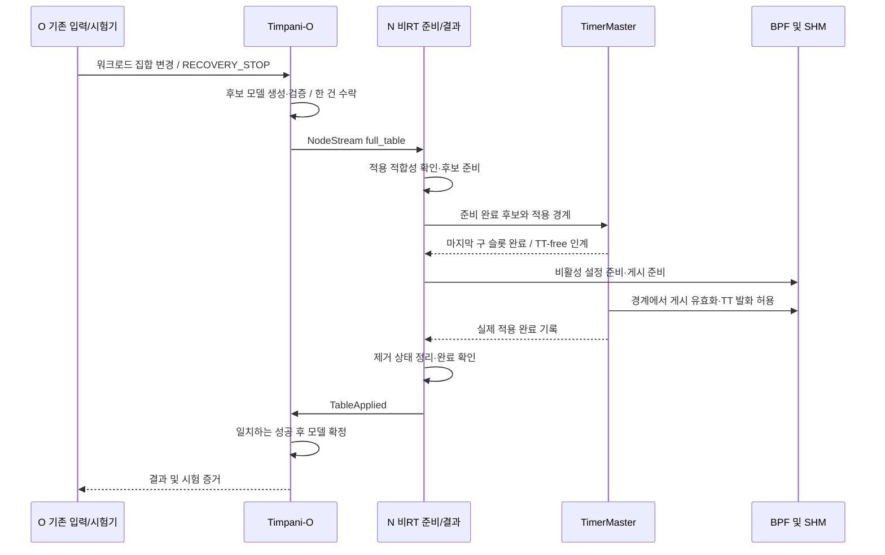

<!--
SPDX-FileCopyrightText: Copyright 2026 LG Electronics Inc.
SPDX-License-Identifier: MIT
-->

# HLD-011: Runtime Table Update — Phase 0 상위 설계

**작성일:** 2026-10-28  
**상태:** Draft — 설계안, 현재 구현의 충족 선언 아님  
**상위 기준:** [REQ-011](../kor/REQ-011-runtime-table-update.md) §1.5·§7.1, [SRS-011](SRS-011-runtime-table-update.md)  
**결정/상세:** [DDR-011](DDR-011-runtime-table-update.md), [LLD-011](LLD-011-runtime-table-update.md)

## 1. 범위와 구조

대상은 단일 노드·사전 지정된 하나 이상의 격리 CPU(유지 태스크 코어 고정)·L1 TT·고정 epoch/전역 hyperperiod이다. 복구 STOP에 따른 제거를 포함한 네 가지 의미론적 연산을 기존 full_table 한 경로로 확인한다. 이 문서는 책임과 정상 흐름만 정의하며 CBS·활성 태스크의 코어 간 이동·롤백·재연결·다중 노드 프로토콜이나 미래 확장용 프레임워크를 설계하지 않는다.

위 흐름은 요구되는 설계이다. 현재 소스의 수신 콜백 반환이나 인덱스 변경만으로 이 흐름이 이미 성립한다고 해석하지 않는다.

## 2. 책임 분리

| 구성 요소 | Phase 0 책임 | 하지 않는 일 |
|:--|:--|:--|
| O 입력/복구·시험 경로 | 워크로드 집합·의미론적 연산 및 `RECOVERY_STOP` 수락, 한 건 결과 후 다음 제출, STOP은 상관 ACK 확인 후 완료 응답 반환 | N에 직접 테이블을 넣고 end-to-end 성공으로 판정, `RecoverySignal`로 테이블 변경 대체 |
| O 생성 경로 | 후보 모델 복사, 후보 주기의 최소 LCM 산출 및 고정 확정 `H`로 나누어지는지 확인, 동일 `H`로 슬롯 확장, 스케줄 가능성 검증, 유지 태스크의 반복 슬롯·CPU 보존 | 후보 최소 LCM으로 고정 실행 프레임 대체, N에 배치 판단 위임, 활성 태스크의 코어 간 이동, 검증 전 확정 모델 수정 |
| O NodeStream 처리 | 기존 full_table 전송, node/table ID 결과 연결, 성공 후 확정 | 요청 대기열·병합·자동 재전송·신규 RPC |
| N 수신/비RT 조정 | 기본 확인(격리 CPU 집합·태스크별 단일 CPU·유지 태스크 CPU 불변 포함), 태스크/PID 해석, 후보 자원 준비·폐기, 정리·로그·ACK | RT 스레드에서 gRPC 호출, 후보 준비 중 활성 항목 삭제 |
| BpfLoader/BPF | TT 설정의 비활성 뱅크 준비, 태스크별 배정 CPU·원자적 실행 카운트 유지, 게이트 폐쇄 중 dispatch가 소비하지 않는 holding queue에 태스크 보관, 새 테이블의 예정 슬롯에만 태스크 해제 및 제외 태스크 비디스패치 제거, 실제 커널 선택과 실행 경계의 일관성 | `SCX_DSQ_LOCAL_ON` 또는 `SCX_DSQ_GLOBAL`에 holding 태스크 삽입, C++ 인덱스만 바꾸고 전환 완료로 간주 |
| TimerMaster | 단일 상주 RT 루프에서 다중 격리 CPU 슬롯의 기존 실행 완료·동일 코어 차기 슬롯 계산·전 코어 인계 동기화·정상 경계 전환·발화 | 갱신마다 RT 스레드 생성/join, RT에서 맵 작성·할당·로그 출력 |
| libttsched/TT 앱 | 유효 게시 해석, 세대 재확인, 실제 슬롯 wake만 잡으로 실행 | 게시 알림이나 무효 SHM을 정상 잡으로 소비 |
| 시험기 | 실행·게시·결과 증거 수집, 전제 이탈 시 시험 중단 | 제품의 안전 정지·자동 복구를 대신 보장 |

기존 공개 메서드·proto·SHM 구조체 레이아웃은 유지한다. 내부 조정 상태와 보조 함수는 모듈 내부에 한정하며 새 공개 API가 필요해지면 별도 승인을 받는다. 기존 결함 감시를 끄거나 안전장치를 제거하지 않는다. 결함 콜백은 보고만 수행하고 자체적으로 워크로드를 제거하지 않으며, 갱신 전후 무관 워크로드의 결함 누적 상태 보존과 전환 실패 복구는 Phase 2로 이관한다.

## 3. H-P0-01 — 입력·생성과 확정 상태

O는 단일 노드에 사전 지정된 격리 CPU 집합(`0..63`) 위에서 `confirmed`와 한 개의 `candidate`만 구분한다. 시험 입력은 기존 생성 경로를 호출하며 스케줄 테이블을 손으로 조립해 N에 우회 주입하지 않는다. 확정 노드 전역 실행 프레임 `H`와 epoch `E`는 CLEAR를 포함한 Phase 0 내내 고정한다. 비어 있지 않은 후보의 TT 주기 최소 LCM을 산출하고 harmonic 집합이며 `H`를 나누는지 확인한 뒤 동일 `H` 전체로 슬롯을 확장한다. 후보 최소 반복 주기는 실행 프레임을 대체하지 않는다. 유지 태스크의 반복 슬롯과 기존 배정 CPU를 그대로 보존하고 신규 워크로드만 미사용 격리 CPU 우선(부족 시 최소 부하 CPU)으로 배정한다. REMOVE는 기존 `RecoveryService.EnforceRecoveryPolicy(RECOVERY_STOP)`와 O 내부 시험 입력 모두 동일한 후보 생성 경로(남은 워크로드가 없으면 빈 테이블)를 사용하며, Phase 0에서는 `RecoverySignal` 브로드캐스트를 보내지 않는다.

후보 생성·검증 실패 및 N의 사전 거절에서는 `confirmed`를 유지한다. 단일 태스크가 여러 CPU에 걸치거나 유지 태스크의 배정 CPU가 바뀌는 경우, 또는 ADD/REMOVE의 유지 슬롯·파라미터가 달라지면 지원하지 않는 변경으로 거절한다. NodeStream의 현재 요청과 일치하는 성공 결과 후에만 후보를 확정하며, 전달 성공은 적용 성공이 아니다. 일반 후보 제출은 등록 후 반환하되, `RECOVERY_STOP`은 호출자가 노드 정리 완료 후에만 워크로드를 종료하도록 유한 대기 기한 내에서 상관된 성공 ACK를 확인한 뒤 성공을 반환하고 세션을 유지한다(사전 거절·진행 중 충돌·미확인 시 실패 반환).

이 구분은 Phase 0의 기본 상태 관리이며, last-known-good 영속화·요청 의도 병합(보류 STOP 포함)·반복 STOP 무해 수렴·재시작 복구 모델로 확장하지 않는다.

## 4. H-P0-02 — N의 사전 확인과 비활성 준비

N은 대상·식별자·값/표현·격리 CPU 마스크 포함 여부·태스크별 단일 CPU 배정·유지 태스크 CPU 불변·로컬 참조·현재 용량 및 고정 시험 조건만 확인한다. 슬롯 간 충돌과 스케줄 가능성은 O 책임으로 남긴다.

하나의 후보에는 정렬된 TT 슬롯, 사용 격리 CPU 비트마스크, 태스크별 배정 CPU를 포함한 해석된 PID/해시, SHM 게시 이미지, 제거 집합, 적용 경계와 완료 기록을 담는다. 이 자료는 비RT 경로에서 만들고 준비 후 불변으로 취급한다. 활성 TT 설정을 지우고 후보를 순서대로 채우는 방식은 사용하지 않는다.

BPF의 TT 슬롯과 태스크별 배정 CPU를 담은 태스크 메타데이터는 함께 선택되는 설정 뱅크로 준비한다. 뱅크를 재사용하기 전 해당 뱅크를 참조하는 커널/타이머 처리가 끝났는지 확인한다. 이는 정상 전환의 참조 수명 규칙이지, Phase 1의 일반적인 은퇴/재시도 상태 기계가 아니다.

수락 중 추가 요청은 즉시 거절한다. 준비 실패는 비활성 후보만 폐기하며, 이 시점의 실패를 전환 후 롤백과 혼동하지 않는다.

## 5. H-P0-03 — 정상 경계 인계

시간은 `CLOCK_REALTIME`의 기존 epoch `E`와 ns로 변환한 노드 전역 양수 hyperperiod `H`를 사용한다. 각 슬롯 발화 시 보고하는 차기 시작 시각은 전체 배열의 다음 슬롯이 아니라 동일 CPU의 차기 슬롯 시각으로 계산한다. 선택한 적용 경계는 $T=E+kH$이고, 시험 테이블은 사용 중인 모든 격리 CPU에서 마지막 구 TT 작업이 끝난 뒤 `T`까지 충분한 공통 TT-free 구간 `[G,T)`을 갖는다.

1. 비RT 경로에서 후보를 준비한다. 인계 시작 전에 준비가 늦으면 활성 테이블은 그대로 두고 이후 경계를 선택한다.
2. 기존 타이머는 마지막 구 슬롯을 완료한 뒤 인계 가능 사실을 기록한다. 활성 또는 후보 테이블에 관여하는 어느 격리 CPU에라도 구 TT 작업·대기 실행이 남아 있거나 커널 참조가 남아 있으면 준비 완료로 보지 않는다.
3. `[G,T)`에는 새 TT 디스패치를 닫는다. 게이트가 닫힌 동안 깨어난 TT 태스크는 select/enqueue/dispatch 경로가 소비하지 않는 배정 CPU holding queue에 보관하며, `SCX_DSQ_LOCAL_ON` 또는 `SCX_DSQ_GLOBAL`에 넣지 않는다. 비RT 경로에서 커널 설정 선택, 관여하는 모든 CPU의 슬롯 상태 초기화(비워지는 코어는 유휴 리셋, 슬롯이 있는 코어는 경계 이후 해당 코어 첫 슬롯 시각 설정)와 SHM 게시를 준비한다. 선택자의 물리적 변경이 먼저 일어나더라도 TT는 실행되지 않고 SHM은 무효 상태여야 한다. 경계 게시 완료 후 게이트를 열 때 새 테이블의 태스크만 예정 슬롯에 따라 해제하고, 제외 태스크는 holding queue에서 제거·정리하며 디스패치하지 않는다.
4. `T`에 상주 타이머가 미리 준비된 값의 고정 개수 atomic store로 타이머 컨텍스트·SHM 유효성·TT 실행 허용을 인계한다. **이후 실제 슬롯 발화 전에는 모든 표현이 같은 후보를 가리켜야 한다.**
5. 실제 적용 완료 사실은 작은 내부 기록으로 비RT 경로에 전달한다. 그 경로에서 제거 항목 정리·확인 후 결과를 보낸다.

TT-free 동안의 실행 차단과 SHM 무효화는 정상 전환 동기화이다. 이를 복원 실패 정지나 일반 노드 건강 상태로 노출하지 않는다. 인계 시작 후 오류 또는 경계 준비 미완료는 시험 실패이며 자동 복원을 약속하지 않는다.

계획 경계 `T`와 실제 완료 관측 시각은 구분해 남긴다. 관측 오차·지터·최악 지연의 수치 보장은 Phase 1 대상이다. 임의 지연 시각을 새로운 epoch로 채택해서는 안 된다.

CLEAR에서도 시간 기준과 제어 경로를 유지한다. 타이머는 TT 발화를 하지 않는 유휴 상태로 같은 격자를 따라 대기하고 후속 후보를 받을 수 있어야 한다.

## 6. H-P0-04 — 앱 가시성과 제거

SHM 구조는 유지하고 기존 `magic`, `generation`, 태스크 이름과 `counter`를 사용한다. 게시 중에는 읽기를 무효화하고 세대가 바뀐 읽기는 버린다. 최종 유효화는 경계 이전에 하지 않는다. 소비자도 읽기 전후 및 futex 반환 후 유효성·세대·자기 태스크를 재확인한다.

유지 태스크의 인덱스/카운터를 보존하는 기존 매핑을 사용하며 게시 때문에 모든 카운터를 증가시키지 않는다. 실제 TT 발화만 잡 카운터를 증가시킨다. 제거 태스크는 유효 게시 조회에서 사라져야 한다. 제거 즉시 wake의 지연 상한이나 구버전 앱 상호운용성까지 보장하지는 않는다.

제거된 TT 맵·태스크 등록·추적 참조는 정상 완료 때 정리한다. OS policy/affinity 복원·컨테이너 종료는 이 경로의 책임이 아니다. SHM 슬롯을 다른 태스크가 사용하더라도 구 대기자가 그 wake를 자기 잡으로 소비하지 않도록 소비자가 신원을 재확인한다.

## 7. H-P0-05 — 결과와 시험 경계

N의 성공은 커널/타이머/앱의 같은 경계 적용과 정상 정리를 확인한 뒤의 결과이다. `TableApplied`의 기존 `table_id/success/error`만 사용하며 결과 코드 스키마를 추가하지 않는다.

사전 거절과 전환 도중 오류를 로그에서 구분한다. 후자의 경우 이전 테이블이 유지됐다고 주장하지 않는다. 시험기는 결과 미확인·연결/시계 이상에서 추가 제출을 중단한다. 이 중단은 시험 절차이고 제품의 fail-safe 기능이 아니다.

증거는 table/node ID, 연산/대상, 계획·실제 시각, 구/신 뱅크, SHM 세대, 실행 태스크, 결과를 기존 로그와 시험 결과 파일로 연결한다. 영속 감사 저장소는 신설하지 않는다.

## 8. 현재 코드와 설계의 차이

| 확인한 소스 | 현재 관찰 및 Phase 0 설계에서 필요한 차이 |
|:--|:--|
| [N 적용 콜백](../../../timpani-n/src/main.cpp) | 수신 직후 기존 항목 삭제·affinity 변경과 맵 재작성을 수행. 사전 확인/후보 준비와 정상 경계 정리를 분리해야 함 |
| [BpfLoader](../../../timpani-n/src/bpf_loader.cpp) | 단일 TT/메타 맵에 기록하고 shadow 메서드는 사용자 인덱스만 변경. 커널 설정의 실제 선택과 인계 연결이 필요 |
| [TimerMaster](../../../timpani-n/src/timer_master.cpp) | SHM 재게시 중 전체 wake 및 스레드 stop/start를 수행. 경계 인계·제어 wake 구분이 필요 |
| [libttsched](../../../sample-apps/src/libttsched.c) | 대기 후 세대/태스크 재확인이 충분하지 않음. 게시/다른 태스크 wake를 잡으로 오인하지 않게 해야 함 |
| [O 결과 처리](../../../timpani-o/src/orchestrator_service.cpp) | ACK를 로그로 출력. 현재 요청 일치 확인·성공 후 모델 확정과 연결해야 함 |

위 표는 구현 작업 목록이나 완료 선언이 아니라 설계의 출발점이다. 관련 소스 변경·빌드·하드웨어 검증은 이번 문서 생성에 포함하지 않는다.

## 9. SRS 추적

| HLD 영역 | 활성 SRS 요구사항 | 검증 |
|:--|:--|:--|
| H-P0-01 | REQ-RTU-P0-F-001..F-004, REQ-RTU-P0-F-016 | TC-P0-01..TC-P0-04, TC-P0-06, TC-P0-09..TC-P0-10 |
| H-P0-02 | REQ-RTU-P0-F-005..F-008, REQ-RTU-P0-N-003 | TC-P0-04, TC-P0-06 |
| H-P0-03 | REQ-RTU-P0-F-009..F-011, REQ-RTU-P0-N-001, REQ-RTU-P0-N-002 | TC-P0-01, TC-P0-03, TC-P0-08..TC-P0-10 |
| H-P0-04 | REQ-RTU-P0-F-012..F-014 | TC-P0-02, TC-P0-03, TC-P0-05 |
| H-P0-05 | REQ-RTU-P0-F-015, REQ-RTU-P0-F-017, REQ-RTU-P0-F-018, REQ-RTU-P0-N-004 | TC-P0-07, TC-P0-08 |